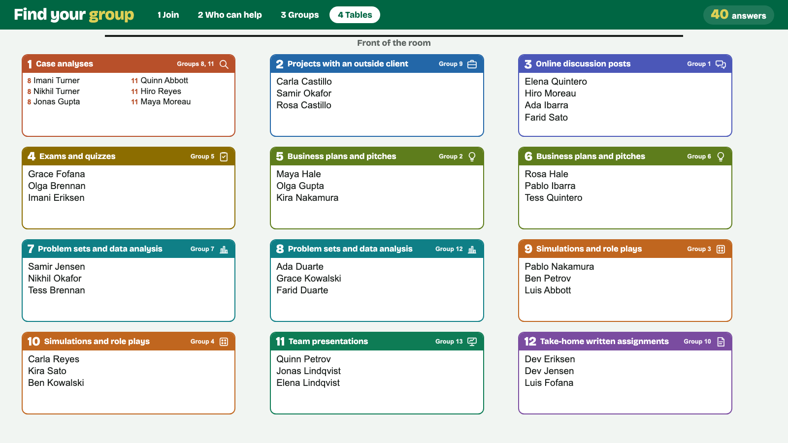
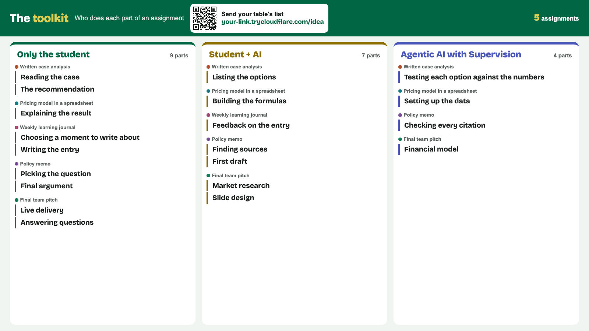

# The Assignment Lab

The Assignment Lab is a small web app for a faculty workshop on assignments and AI. People answer on their phones, the host screen sorts them into groups at tables, and each table adds one assignment to a shared toolkit.

## What happens in the room

1. Everyone scans a QR code and says which assignments they give and how they use AI on each one.
2. The host presses Make groups. Each phone shows its table and group, and the room map on the projector shows every name at every table.
3. The people at each table pick one assignment of their kind and list its parts. For each part, they pick Only the student, Student + AI, or Agentic AI with Supervision.
4. The toolkit screen shows every table's parts in three columns, one for each choice.

## What you need

- You need a laptop that stays on for the session and connects to the projector. A Mac or a Windows laptop works.
- You need Claude Desktop with the Code tab, which comes with a paid Claude plan.
- The laptop needs the internet. Phones can be on any network, including cell data.

## Set it up with Claude Desktop

1. On this page, press the green Code button, then Download ZIP. Unzip the file.
2. Open Claude Desktop, go to the Code tab, and choose the unzipped folder.
3. Type **Start the Assignment Lab**.

Claude installs what the lab needs, asks about your room, starts the lab, and gives you two links. Claude opens the host screen in your browser. You share the link for phones with the room.

To try it first, type **Start the Assignment Lab with sample people**. The sample answers stay apart from real ones.

## Run it without Claude

1. Install Node 18 or newer from https://nodejs.org.
2. Install cloudflared, which gives the lab a free link that phones can reach. You don't need a Cloudflare account.
   - On a Mac with Homebrew, run `brew install cloudflared`.
   - On Windows, run `winget install --id Cloudflare.cloudflared`.
   - On anything else, download it from https://github.com/cloudflare/cloudflared/releases.
3. In this folder, run `node start.js`.

| Command | What it does |
|---|---|
| `node start.js` | Starts the lab with a Cloudflare link for phones |
| `node start.js --demo` | Starts the lab with 40 sample people and five toolkit lists |
| `node start.js --wifi` | Starts the lab without Cloudflare, for phones on the same Wi-Fi as the laptop |
| `node start.js --no-open` | Starts the lab without opening the browser |
| `node start.js --port 4100` | Starts the lab on another port |

Press Ctrl+C to stop the lab.

## Run the session

1. Open the host screen on the laptop and put Find your group on the projector.
2. When most people have answered, move the pointer to the bottom of the screen and press Make groups. Press 4 to show the room map.
3. When people answer late, press Add new answers to groups. Nobody else moves.
4. Put the toolkit screen on the projector. One person at each table scans its QR code and sends the table's list.
5. After the session, download the toolkit lists and the groups from the host screen. Each file opens in Excel or Google Sheets.

## Change the room and the assignments

Claude can change these for you. To change them yourself, edit `settings.json` and start the lab again.

| Setting | What it changes |
|---|---|
| `title` | The name at the top of every page |
| `hostName` | The name phones show for the host, as in "Dana puts you in a small group" |
| `room.tables`, `room.seatsPerTable` | The number of tables and the seats at each one |
| `room.tablesPerRow`, `room.staggerRows` | The shape of the room map |
| `groupSize` | 3 or 4, the starting size of each group |
| `department` | Whether the form asks each person's department, and the choices |
| `toolkitChoices` | The labels for Only the student, Student + AI, and Agentic AI with Supervision |
| `assignments` | The kinds of assignment, each with an `id`, a `name`, and a `hint` |

## Who can see what

- The lab keeps the answers on your laptop in the `data` folder.
- Anyone with the link can open the screens, which show the same names and groups as the projector.
- Only the laptop that runs the lab can make groups, delete answers, or download the results.
- The link stops working when you stop the lab. The next start gets a new link.
- After the session, press Delete all answers and lists on the host screen, or delete the `data` folder.

## About

Jonathan Sims built the Assignment Lab with Claude for a faculty workshop at Babson College in October 2026. It uses plain Node with no packages. The QR codes come from [node-qrcode](https://github.com/soldair/node-qrcode), which is in `vendor/` under its MIT license. The lab itself is under the MIT license in `LICENSE`.
